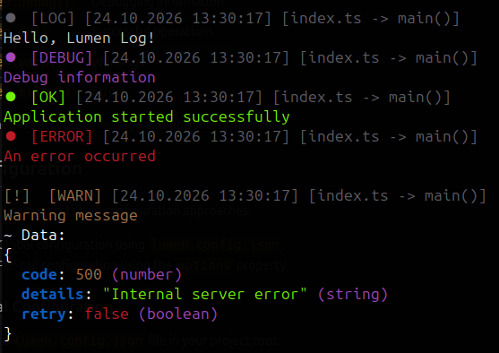

# Lumen Log

[English](#english) | [Русский](#русский)

---

<a id="english"></a>

# Lumen Log



**Lumen Log** is a customizable logging library for Node.js that provides extended logging capabilities out of the box.

It supports colored output, multiple log levels, file logging, Telegram notifications, structured data visualization, and flexible configuration.

## Features

- **Multiple log levels** — `log`, `debug`, `ok`, `error`, and `warn`.
- **Colored output** — visually distinguish log levels and their contents.
- **File logging** — automatically create log directories and organize logs by type and date.
- **Telegram integration** — send logs to Telegram chats using a Telegram Bot.
- **Structured data** — display objects, arrays, nested values, and their types directly in the console.
- **Flexible configuration** — configure the logger globally through `lumen.config.json` or override settings for individual log calls.
- **Caller information** — optionally display the calling function and file name.
- **Date and time** — include timestamps in log messages.
- **Custom markers and padding** — customize the appearance of your logs.

## Requirements

- Node.js 18 or higher.
- ESM-compatible project.

## Installation

Install the package using npm:

```bash
npm install lumen-log
```

## Quick Start

Import `Lumen` and start logging:

```ts
import { Lumen } from 'lumen-log'

Lumen.log('Hello, Lumen Log!')
Lumen.debug('Debug information')
Lumen.ok('Operation completed successfully')
Lumen.warn('Warning message')
Lumen.error('Something went wrong')
```

## Log Levels

Lumen Log provides five logging methods:

| Method | Description |
|---|---|
| `Lumen.log()` | General information |
| `Lumen.debug()` | Debugging information |
| `Lumen.ok()` | Successful operations |
| `Lumen.warn()` | Warnings |
| `Lumen.error()` | Errors |

Each method accepts a message and optional properties.

## Configuration

Lumen Log supports two configuration approaches:

1. Global configuration using `lumen.config.json`.
2. Per-call configuration using the `options` property.

### Global Configuration

Create a `lumen.config.json` file in your project root:

```json
{
  "logInFile": false,
  "logInFileForDebug": false,
  "telegram": {
    "logInTelegram": false,
    "api": "YOUR_TELEGRAM_BOT_TOKEN",
    "chatsIds": []
  },
  "nameCaller": true,
  "nameFileCaller": true,
  "timeCall": true,
  "dateCall": true,
  "padding": false,
  "marker": "⏺"
}
```

Lumen Log searches for `lumen.config.json` starting from the current working directory and moving up through parent directories.

### Configuration Options

| Option | Type | Default | Description |
|---|---|---|---|
| `logInFile` | `boolean` | `false` | Enable file logging |
| `logInFileForDebug` | `boolean` | `false` | Enable file logging for debug messages |
| `telegram.logInTelegram` | `boolean` | `false` | Enable Telegram logging |
| `telegram.api` | `string` | — | Telegram Bot API token |
| `telegram.chatsIds` | `number[]` | — | Telegram chat IDs |
| `nameCaller` | `boolean` | `true` | Display the calling function name |
| `nameFileCaller` | `boolean` | `true` | Display the caller file name |
| `timeCall` | `boolean` | `true` | Display the time |
| `dateCall` | `boolean` | `true` | Display the date |
| `padding` | `boolean` | `false` | Enable additional log padding |
| `marker` | `string` | `⏺` | Customize the log marker |

### Per-call Configuration

You can override configuration options for an individual log message:

```ts
Lumen.warn('Something needs attention', {
  options: {
    logInFile: true,
    telegram: {
      logInTelegram: true
    },
    marker: '[!]',
    padding: true
  }
})
```

This allows you to customize individual messages without changing the global configuration.

## File Logging

Lumen Log can automatically save messages to files.

Enable file logging in your configuration:

```json
{
  "logInFile": true
}
```

When enabled, Lumen Log creates the necessary directories and organizes log files by log type.

Log files are named using the date, making it easier to find and review logs from a specific day.

You can also enable file logging for individual messages:

```ts
Lumen.error('Database connection failed', {
  options: {
    logInFile: true
  }
})
```

Debug logging can be configured separately using `logInFileForDebug`.

## Telegram Integration

Lumen Log can send log messages directly to Telegram using a Telegram Bot.

### 1. Create a Telegram Bot

1. Open Telegram.
2. Find [@BotFather](https://t.me/BotFather).
3. Create a new bot using `/newbot`.
4. Copy the bot token.

### 2. Configure Telegram

Add your bot token and chat IDs to `lumen.config.json`:

```json
{
  "telegram": {
    "logInTelegram": true,
    "api": "YOUR_TELEGRAM_BOT_TOKEN",
    "chatsIds": [
      123456789
    ]
  }
}
```

Keep your bot token private. Do not commit real tokens to public repositories. Use environment variables or another secure configuration mechanism for production deployments.

### 3. Send Logs to Telegram

Enable Telegram logging globally or for individual messages:

```ts
Lumen.error('Critical application error', {
  options: {
    telegram: {
      logInTelegram: true
    }
  }
})
```

**Important:** A Telegram bot cannot start a private conversation with a user who has never interacted with it. The user must first open the bot and send a message or start it. For groups, add the bot to the group and obtain the appropriate chat ID.

## Structured Data Logging

Lumen Log supports passing additional data along with a log message.

Objects, arrays, nested structures, and values are displayed with their types and visual formatting.

Example:

```ts
Lumen.log('User information', {
  data: {
    id: 123,
    name: 'John',
    active: true,
    roles: ['admin', 'user'],
    settings: {
      theme: 'dark',
      notifications: false
    }
  }
})
```

This makes it easier to inspect application data without manually formatting objects.

## Complete Example

```ts
import { Lumen } from 'lumen-log'

const main = () => {
  Lumen.log('Hello, Lumen Log!')

  Lumen.debug('Debug information')

  Lumen.ok('Application started successfully')

  Lumen.error('An error occurred')

  Lumen.warn('Warning message', {
    options: {
      logInFile: true,
      telegram: {
        logInTelegram: true
      },
      marker: '[!]',
      padding: true
    },
    data: {
      code: 500,
      details: 'Internal server error',
      retry: false
    }
  })
}

main()
```

## TypeScript Support

Lumen Log is written in TypeScript and includes TypeScript declaration files.

The package exports:

```ts
import { Lumen } from 'lumen-log'

import type {
  ILoggerProps,
  Message,
  TypeLog
} from 'lumen-log'
```

## License

MIT License.

---

<a id="русский"></a>

# Lumen Log

**Lumen Log** — это библиотека для Node.js, предоставляющая расширенные возможности логирования из коробки.

Она поддерживает цветной вывод, несколько типов логов, запись в файлы, отправку сообщений в Telegram, отображение структурированных данных и гибкую настройку.

## Возможности

- **Разные типы логов** — `log`, `debug`, `ok`, `error` и `warn`.
- **Цветной вывод** — визуальное разделение типов логов и их содержимого.
- **Запись в файлы** — автоматическое создание директорий и сортировка логов по типам и датам.
- **Интеграция с Telegram** — отправка логов в Telegram через бота.
- **Структурированные данные** — отображение объектов, массивов, вложенных значений и их типов прямо в консоли.
- **Гибкая настройка** — глобальная конфигурация через `lumen.config.json` или индивидуальные настройки для отдельных вызовов.
- **Информация о вызове** — возможность отображать имя вызывающей функции и файла.
- **Дата и время** — добавление временных меток к сообщениям.
- **Маркеры и отступы** — настройка внешнего вида логов.

## Требования

- Node.js 18 или выше.
- Проект с поддержкой ESM.

## Установка

Установите пакет через npm:

```bash
npm install lumen-log
```

## Быстрый старт

Импортируйте `Lumen` и начинайте логирование:

```ts
import { Lumen } from 'lumen-log'

Lumen.log('Hello, Lumen Log!')
Lumen.debug('Отладочная информация')
Lumen.ok('Операция успешно выполнена')
Lumen.warn('Предупреждение')
Lumen.error('Произошла ошибка')
```

## Типы логов

Lumen Log предоставляет пять методов логирования:

| Метод | Описание |
|---|---|
| `Lumen.log()` | Обычная информация |
| `Lumen.debug()` | Отладочная информация |
| `Lumen.ok()` | Успешное выполнение операций |
| `Lumen.warn()` | Предупреждения |
| `Lumen.error()` | Ошибки |

Каждый метод принимает сообщение и необязательные дополнительные параметры.

## Настройка

Lumen Log поддерживает два способа настройки:

1. Глобальная конфигурация через `lumen.config.json`.
2. Индивидуальная настройка каждого вызова через свойство `options`.

### Глобальная конфигурация

Создайте файл `lumen.config.json` в корне проекта:

```json
{
  "logInFile": false,
  "logInFileForDebug": false,
  "telegram": {
    "logInTelegram": false,
    "api": "YOUR_TELEGRAM_BOT_TOKEN",
    "chatsIds": []
  },
  "nameCaller": true,
  "nameFileCaller": true,
  "timeCall": true,
  "dateCall": true,
  "padding": false,
  "marker": "⏺"
}
```

Lumen Log ищет `lumen.config.json`, начиная с текущей рабочей директории и поднимаясь вверх по родительским директориям.

### Параметры конфигурации

| Параметр | Тип | По умолчанию | Описание |
|---|---|---|---|
| `logInFile` | `boolean` | `false` | Включить запись логов в файлы |
| `logInFileForDebug` | `boolean` | `false` | Включить запись debug-сообщений в файлы |
| `telegram.logInTelegram` | `boolean` | `false` | Включить отправку логов в Telegram |
| `telegram.api` | `string` | — | Токен Telegram Bot API |
| `telegram.chatsIds` | `number[]` | — | ID чатов Telegram |
| `nameCaller` | `boolean` | `true` | Отображать имя вызывающей функции |
| `nameFileCaller` | `boolean` | `true` | Отображать имя файла вызова |
| `timeCall` | `boolean` | `true` | Отображать время |
| `dateCall` | `boolean` | `true` | Отображать дату |
| `padding` | `boolean` | `false` | Включить дополнительные отступы |
| `marker` | `string` | `⏺` | Изменить маркер лога |

### Индивидуальная настройка

Можно переопределять настройки для отдельного сообщения:

```ts
Lumen.warn('Требуется внимание', {
  options: {
    logInFile: true,
    telegram: {
      logInTelegram: true
    },
    marker: '[!]',
    padding: true
  }
})
```

Это позволяет настраивать отдельные сообщения, не изменяя глобальную конфигурацию.

## Запись логов в файлы

Lumen Log умеет автоматически сохранять сообщения в файлы.

Включите запись в конфигурации:

```json
{
  "logInFile": true
}
```

При включении этой функции Lumen Log самостоятельно создаёт необходимые директории и сортирует файлы по типам логов.

Файлы именуются по дате, благодаря чему можно легко находить и просматривать логи за определённый день.

Также можно включить запись только для отдельных сообщений:

```ts
Lumen.error('Не удалось подключиться к базе данных', {
  options: {
    logInFile: true
  }
})
```

Запись debug-логов настраивается отдельно через `logInFileForDebug`.

## Интеграция с Telegram

Lumen Log поддерживает отправку логов напрямую в Telegram через Telegram Bot.

### 1. Создание Telegram Bot

1. Откройте Telegram.
2. Найдите [@BotFather](https://t.me/BotFather).
3. Создайте нового бота командой `/newbot`.
4. Скопируйте токен бота.

### 2. Настройка Telegram

Добавьте токен бота и ID чатов в `lumen.config.json`:

```json
{
  "telegram": {
    "logInTelegram": true,
    "api": "YOUR_TELEGRAM_BOT_TOKEN",
    "chatsIds": [
      123456789
    ]
  }
}
```

Храните токен бота в безопасности. Не добавляйте настоящий токен в публичные репозитории. Для production используйте переменные окружения или другой безопасный способ хранения конфигурации.

### 3. Отправка логов в Telegram

Включить отправку можно глобально или для отдельных сообщений:

```ts
Lumen.error('Критическая ошибка приложения', {
  options: {
    telegram: {
      logInTelegram: true
    }
  }
})
```

**Важно:** Telegram-бот не может первым начать личный диалог с пользователем, который ещё ни разу с ним не взаимодействовал. Пользователь должен сначала открыть бота и отправить сообщение или выполнить `/start`. Для групп добавьте бота в группу и получите соответствующий ID чата.

## Логирование структурированных данных

Lumen Log позволяет передавать дополнительные данные вместе с сообщением.

Объекты, массивы, вложенные структуры и значения отображаются с указанием типов и визуальным форматированием.

Пример:

```ts
Lumen.log('Информация о пользователе', {
  data: {
    id: 123,
    name: 'John',
    active: true,
    roles: ['admin', 'user'],
    settings: {
      theme: 'dark',
      notifications: false
    }
  }
})
```

Это упрощает просмотр данных приложения без необходимости вручную форматировать объекты.

## Полный пример

```ts
import { Lumen } from 'lumen-log'

const main = () => {
  Lumen.log('Hello, Lumen Log!')

  Lumen.debug('Отладочная информация')

  Lumen.ok('Приложение успешно запущено')

  Lumen.error('Произошла ошибка')

  Lumen.warn('Предупреждение', {
    options: {
      logInFile: true,
      telegram: {
        logInTelegram: true
      },
      marker: '[!]',
      padding: true
    },
    data: {
      code: 500,
      details: 'Внутренняя ошибка сервера',
      retry: false
    }
  })
}

main()
```

## Поддержка TypeScript

Lumen Log написан на TypeScript и содержит файлы деклараций типов.

Доступен следующий импорт:

```ts
import { Lumen } from 'lumen-log'

import type {
  ILoggerProps,
  Message,
  TypeLog
} from 'lumen-log'
```

## Лицензия

MIT License.